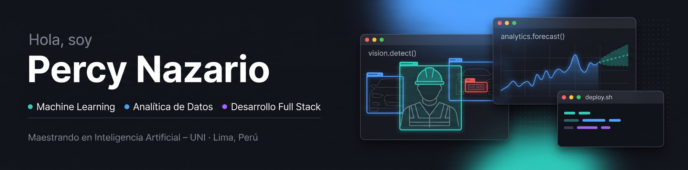

  

  
  
  
  

## Sobre mí

Analista de Datos y Sistemas en **GDS Infraestructura** y maestrando en **Inteligencia Artificial en la UNI**, con base en Investigación Operativa (UNMSM). Construyo modelos de machine learning y soluciones de datos que llegan a producción: visión por computador, forecasting y automatización de procesos.

- **Ahora:** investigo un traductor de Lengua de Señas Peruana a lenguaje natural para atención médica (visión por computador + NLP en un sistema embebido).
- **En el trabajo:** integro fuentes de datos, defino reglas de calidad y construyo indicadores de cumplimiento (SLA) para más de 1.700 tickets de mantenimiento.
- **También enseño:** comparto contenido sobre IA y análisis de datos en [YouTube](https://www.youtube.com/@percytech).

## Proyectos destacados

| Proyecto | Qué hace | Stack | Resultado |
|---|---|---|---|
| [**Cumplimiento de EPP con YOLOv8**](https://github.com/PercyTechX/epp-yolo-compliance) | Detecta casco y chaleco en obras y clasifica a cada trabajador como conforme, no conforme o indeterminado. | YOLOv8 · PyTorch · Kaggle | mAP@0.5 de **0,771** en 3.895 imágenes de prueba; ≥ 0,947 en las clases críticas |
| [**Lector de placas peruanas**](https://github.com/PercyTechX/PercyTechX/blob/main/MIA_YOLO_OCR.ipynb) | Detecta placas con YOLO11 y las lee con un modelo de visión y lenguaje, con seguimiento y votación por placa en video. | YOLO11 · Qwen2.5-VL · Roboflow | mAP@0.5 de **0,986** en validación |
| **Forecasting de tráfico en peajes** | Pronostica el tráfico vehicular y proyecta el costo de los peajes a 3 años. | Python · ARIMA / SARIMA | MAPE **< 5 %** con backtesting |
| [**RindePe**](https://github.com/PercyTechX/rindepe-demo) | Control de caja chica para técnicos de campo: flujo de aprobación, KPIs en tiempo real y hoja resumen en PDF. | React · TypeScript · Node.js | En producción en una empresa de ingeniería |
| [**TuSueldo.pe**](https://www.tusueldo.pe) | Calculadoras laborales para trabajadores peruanos: CTS, gratificación, vacaciones, liquidación y sueldo neto. | HTML · CSS · JavaScript | En producción |

**Proyectos profesionales** (código privado por contener datos de clientes):
- **Portal de seguimiento de SLA multicliente:** integra ERP, GLPI y correo, aplica 15 reglas de calidad de datos y redujo el reporte semanal para gerencia de 1 día a 5 minutos.
- **Sistema de RRHH en producción:** más de 20 módulos, asistencia por GPS con geocerca e integración con SharePoint vía Microsoft Graph. Ahorra 48 horas al mes.

## Stack

**Machine learning y datos**

**Desarrollo**

## Material educativo

- [Python for Analytics](https://percytechx.github.io/Python-For-Anlytics/)
- [Power Query](https://percytechx.github.io/Power-Query/)

---

¿Trabajas en analytics o machine learning? Escríbeme a <a href="mailto:jpnazariop@gmail.com">jpnazariop@gmail.com</a> o por <a href="https://www.linkedin.com/in/percy-nazario/">LinkedIn</a>.

